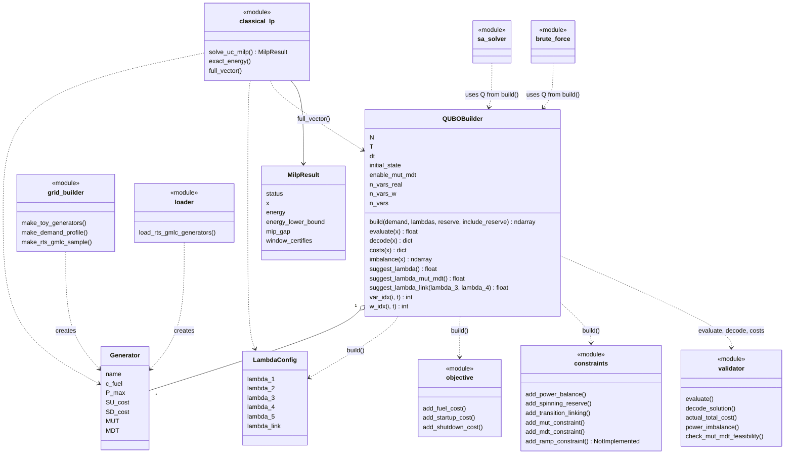

# FluxQ

**Quantum-native unit commitment for the renewable grid.**

[]()
[]()
[]()

I started this project because I wanted to actually understand QUBO, not just read about it. FluxQ is what came out of that.

It's an open-source framework that reformulates the **Unit Commitment Problem (UCP)** — deciding which power generators to switch on or off, and when, to meet electricity demand at the lowest possible cost — as a **QUBO (Quadratic Unconstrained Binary Optimization)** problem, so it can be solved on gate-based quantum computers (QAOA via Qiskit, planned), quantum annealers (D-Wave), or classical solvers.

Every formula in here was worked out by hand before it became code, and the results are checked against brute-force enumeration, an exact MILP solve, or real generator data pulled from RTS-GMLC — not numbers invented to make a demo look clean. The [research log](docs/research-log.md) documents the whole process, mistakes and corrections included, not just the parts that worked on the first try.

---

## The problem

Every grid operator faces a daily decision: which generators — coal, gas, wind, solar — do you switch **on or off**, and **when**, across a 24–48 hour window, to meet demand at minimum cost?

With 20–30% renewable penetration, this problem is exponentially harder. Existing MILP solvers (CPLEX, Gurobi) break down under uncertainty and real-time redispatch requirements. FluxQ investigates whether QUBO/quantum approaches close the gap.

## Why QUBO

The UCP is natively binary: every generator at every timestep is a 0/1 decision. QUBO is the native language of binary combinatorial optimization:

```
minimize  x^T Q x     where x ∈ {0,1}^n, Q is an n×n real matrix
```

Every constraint becomes a penalty term in Q. Every objective term becomes a diagonal or off-diagonal entry. Once in QUBO form, the problem can be solved by:

- **QAOA** on a gate-based quantum computer (via Qiskit) — planned
- **Quantum Annealing** on a D-Wave system
- **Simulated Annealing** (classical baseline) — implemented
- **Exact MILP** (HiGHS via SciPy) — implemented as a reference for the QUBO energy
- **Gurobi/CPLEX** (classical benchmark) — not yet

---

## What makes this different

Most published QUBO formulations of the UCP:
1. Ignore minimum up/down time constraints (too hard to encode)
2. Use energy throughput as a proxy for renewable uncertainty (physically wrong)
3. Never benchmark against Gurobi on real grid data
4. Never analyse QUBO size scaling vs grid size

**FluxQ is working toward all four.** Status today: MUT/MDT are encoded (with an auxiliary-variable reduction, see below); a first exact classical baseline exists (HiGHS, not Gurobi/CPLEX); renewables and the size-scaling analysis are still ahead.

---

## Repository structure

```
fluxq/
├── fluxq/
│   ├── qubo/
│   │   ├── builder.py        ← QUBOBuilder: the main entry point
│   │   ├── objective.py      ← Fuel, startup, shutdown cost terms
│   │   ├── constraints.py    ← Power balance, reserve, transition linking, MUT/MDT (ramp rate: stub)
│   │   └── validator.py      ← Energy evaluation, decoding, reporting, MUT/MDT feasibility check
│   ├── data/
│   │   ├── grid_builder.py   ← Generator dataclass, toy/IEEE14/RTS-GMLC samples, demand profiles
│   │   └── loader.py         ← RTS-GMLC gen.csv loader, pandapower / MATPOWER loader
│   ├── solvers/
│   │   ├── sa_solver.py      ← Simulated annealing
│   │   ├── brute_force.py    ← Exhaustive enumeration for small instances
│   │   └── classical_lp.py   ← Exact MILP reference (HiGHS via SciPy)
│   └── metrics/               ← Benchmarking utilities (Phase 2)
├── tests/                     ← Unit tests (run `pytest`)
├── demos/
│   ├── toy_brute_force.py             ← Phase 0 synthetic verification
│   ├── rts_gmlc_5gen_brute_force.py   ← First real-data verification
│   ├── rts_gmlc_scaling_demo.py       ← SA on 15 RTS-GMLC units, T=8
│   ├── constant_schedule_check.py     ← Enumerates all 2^15 constant schedules
│   └── sa_scale_diagnostic.py, w_soundness_check.py, sa_rerun_audit.py
│                                      ← Diagnostics behind the 2026-11-07 research-log entry
├── notebooks/                 ← Jupyter walkthroughs (Phase 0–5)
├── datasets/                  ← Real dataset references (RTS-GMLC, etc.)
└── docs/
    ├── research-log.md        ← Every paper read, formula derived, bug found — in order
    └── glossary.md            ← Every term and dataset field explained, once
```

## Architecture (UML)

Class and module view of the QUBO pipeline. Rectangles tagged `<<module>>` are plain modules of functions, not classes.



---

## Quick start

```bash
pip install -r requirements.txt
```

SciPy is needed only for `fluxq/solvers/classical_lp.py`.

```python
from fluxq.data.grid_builder import make_toy_generators
from fluxq.qubo.builder import QUBOBuilder, LambdaConfig
import numpy as np

# 3-generator toy system
generators = make_toy_generators()
builder    = QUBOBuilder(generators, T=4)
demand     = np.array([200., 280., 350., 220.])   # MW per hour

lam = builder.suggest_lambda()
Q   = builder.build(demand, LambdaConfig(lambda_1=lam * 1.5))

print(f"QUBO matrix: {Q.shape}, state space: 2^{builder.n_vars}")
# → QUBO matrix: (12, 12), state space: 2^12
```

With minimum up/down time enabled, the builder adds one auxiliary variable per (generator, timestep) and `lambda_link` must be set. Always pass both penalty weights to `suggest_lambda_link`:

```python
builder = QUBOBuilder(generators, T=T, enable_mut_mdt=True)
lam_mm  = builder.suggest_lambda_mut_mdt()
lambdas = LambdaConfig(
    lambda_1=builder.suggest_lambda() * 1.5,
    lambda_3=lam_mm, lambda_4=lam_mm,
    lambda_link=builder.suggest_lambda_link(lam_mm, lam_mm),
)
Q = builder.build(demand, lambdas)
```

### Run the verification demos

```bash
python demos/toy_brute_force.py               # synthetic 3-generator system
python demos/rts_gmlc_5gen_brute_force.py      # real RTS-GMLC generators
```

Both enumerate every possible schedule and confirm the QUBO-optimal solution matches the true, hand-verifiable optimum.

### Exact MILP reference for the 15-unit instance

```bash
python -m fluxq.solvers.classical_lp   # run from the repo root
```

This expects an RTS-GMLC checkout next to the repo (or `RTS_GMLC_PATH` pointing at `gen.csv`).

---

## QUBO formulation

### Variables

```
x_{i,t} ∈ {0,1}    i = generator index, t = timestep index
w_{i,t} ∈ {0,1}    auxiliary, only when MUT/MDT is enabled; t ≥ 1
```

For N generators and T timesteps: **N × T** real variables, indexed `i * T + t`, plus **N × (T−1)** auxiliary `w` variables when MUT/MDT is enabled.

### Objective

```
min Σ_{i,t} [ c_i · P_i · x_{i,t} · Δt          (fuel cost)
            + SU_i · max(0, x_{i,t} - x_{i,t-1}) (startup cost)
            + SD_i · max(0, x_{i,t-1} - x_{i,t}) (shutdown cost) ]
```

All three terms are QUBO-native. For binary variables:

```
max(0, x_t - x_{t-1}) = x_t - x_t · x_{t-1}    →  diagonal + off-diagonal entry
```

### Power balance

```
λ₁ · Σ_t (Σ_i P_i · x_{i,t} - D_t)²
```

Expanding the square gives diagonal terms `λ₁ · P_i · (P_i − 2D_t)` and off-diagonal terms `2λ₁ · P_i · P_j`. Each unit is either ON at its full `P_max` or OFF, so exact balance is a subset-sum condition and a small residual imbalance is normal.

**Choosing λ₁:** must dominate the maximum possible objective savings. Use `builder.suggest_lambda()` for an automatic lower bound.

### Minimum up/down time (MUT/MDT)

A start event followed by a violating step expands to a cubic term, which a QUBO cannot hold. FluxQ applies Rosenberg's reduction: an auxiliary `w_{i,t}` is forced to equal `x_{i,t-1} · x_{i,t}` by the penalty

```
λ_link · ( a·b − 2·a·w − 2·b·w + 3·w )      a = x_{i,t-1}, b = x_{i,t}
```

and every MUT/MDT term is then written with `w` in place of the product. Each violating (start, later step) pair costs `λ₃` (MUT) or `λ₄` (MDT). Only pairs that lie fully inside the planning horizon are penalised, so a start near the end of the horizon is not fully checked. `validator.check_mut_mdt_feasibility()` is the independent check.

**Choosing λ_link:** it must be large enough that no w bit can profit from disagreeing with the product. From the encoding, a sufficient condition is `λ_link ≥ max_i((MUT_i − 1)·λ₃ + (MDT_i − 1)·λ₄)`, which is what `suggest_lambda_link(λ₃, λ₄)` returns. An earlier choice of `2·λ₃` was unsound at T=8 (see the research log). `suggest_lambda_link` ignores horizon truncation, so it is looser than needed.

### Not yet implemented

- Ramp rate limits (`add_ramp_constraint` raises `NotImplementedError`)
- Spinning reserve as a true one-sided inequality (the current term is an equality approximation, off by default)

---

## Current findings

Instance: first 15 dispatchable RTS-GMLC units, T = 8, flat demand 668.44 MW, 225 variables (120 `x` + 105 `w`). Details, numbers and caveats are in the [research log](docs/research-log.md).

- **Exact reference.** The best constant schedule (each unit ON or OFF for all 8 steps; 8 units ON, max imbalance 0.56 MW, no MUT/MDT violations) has QUBO energy −11,322,757,836.93. The MILP baseline in `classical_lp.py` returns the same energy with `mip_gap = 0.0`, so for this instance it is the minimum over product schedules (`w = x[t-1]·x[t]`), up to solver tolerances. This is one instance with a flat demand profile.
- **Simulated annealing.** Plain single-flip SA with geometric cooling, three configurations, one seed each, did not reach a MUT/MDT-feasible schedule at N = 15, T = 8. The best default configuration ended 2,850,513 above the minimum with 21 violations. This is a statement about those runs, not about SA in general.
- **Penalty weights matter.** `λ_link = 2·λ₃` was unsound at T = 8: the energy-minimising `w` differed from the product on about 10% of bits. Fixed by `suggest_lambda_link`.

---

## Build roadmap

| Phase | Status | Content |
|---|---|---|
| **0** | ✅ Complete | QUBO builder, power balance, brute-force verification (synthetic + real RTS-GMLC data) |
| **1** | 🔄 In progress | MUT/MDT encoding ✅, Simulated Annealing ✅ (no feasible schedule yet at N=15, T=8), exact MILP reference ✅ (one instance). Open: QUBO size table, `w == product` regression test, horizon-aware `lambda_link`, ramp rate |
| **2** | ⬜ Planned | QAOA via Qiskit, small-system quantum benchmarks |
| **3** | ⬜ Planned | Renewable scenario extension (NREL wind/solar data) |
| **4** | ⬜ Planned | Scaling analysis, Lagrangian decomposition |
| **5** | ⬜ Planned | arXiv preprint, IEEE TPS submission |

---

## Mathematical note on QUBO energies

FluxQ uses the **upper-triangular convention**:

```
E(x) = x^T Q x = Σ_i Q[i,i] · x_i + Σ_{i<j} Q[i,j] · x_i · x_j
```

Q drops constants that do not affect the argmin: `λ₁ · Σ_t D_t²` from the power-balance penalty, and `SD_i` for any unit that starts the horizon ON. Absolute QUBO energies are therefore shifted (about −1.13e10 for the instance above) — use `validator.actual_total_cost()` or `builder.costs(x)` for true operational costs.

---

## Data sources

| Dataset | Content | Status |
|---|---|---|
| **RTS-GMLC** | Real generator technical parameters (NREL/GMLC test system) | ✅ Integrated — see `fluxq/data/grid_builder.py::make_rts_gmlc_sample()` and `fluxq/data/loader.py::load_rts_gmlc_generators()` |
| MATPOWER | IEEE 14/30/118-bus test cases | `pip install pandapower` |
| NREL Wind Toolkit | Hourly US wind output | https://www.nrel.gov/grid/wind-toolkit.html |
| NREL Solar Resource | Hourly solar irradiance | https://nsrdb.nrel.gov |
| ERCOT load data | Texas hourly load profiles | https://www.ercot.com/gridinfo/load/load_hist |

---

## Research log and glossary

Every paper read, formula derived by hand, bug found, and decision made — in chronological order, including the mistakes: **[docs/research-log.md](docs/research-log.md)**

Every term, abbreviation, and dataset field used across the project, explained once: **[docs/glossary.md](docs/glossary.md)**

---

## Citation

If you use FluxQ in your research, please cite:

```bibtex
@software{fluxq2026,
  title  = {FluxQ: A QUBO Framework for Unit Commitment in Renewable-Heavy Power Grids},
  year   = {2026},
  url    = {https://github.com/Ra-1-boss/fluxq}
}
```

---

## License

Apache 2.0. See `LICENSE`.